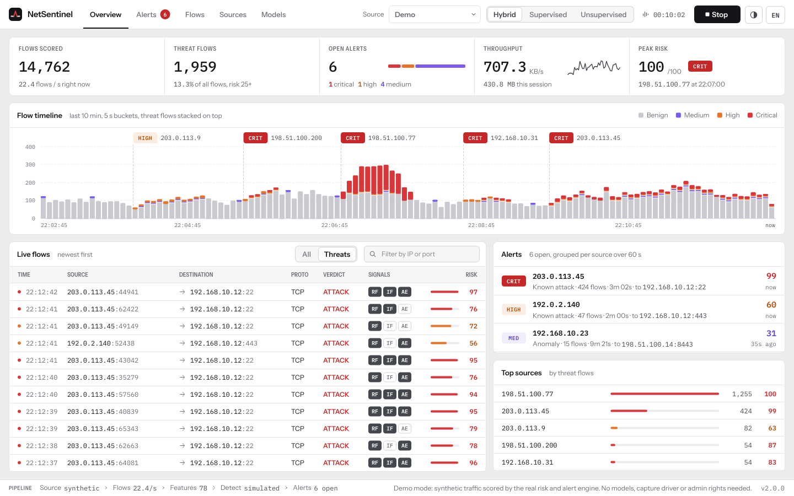
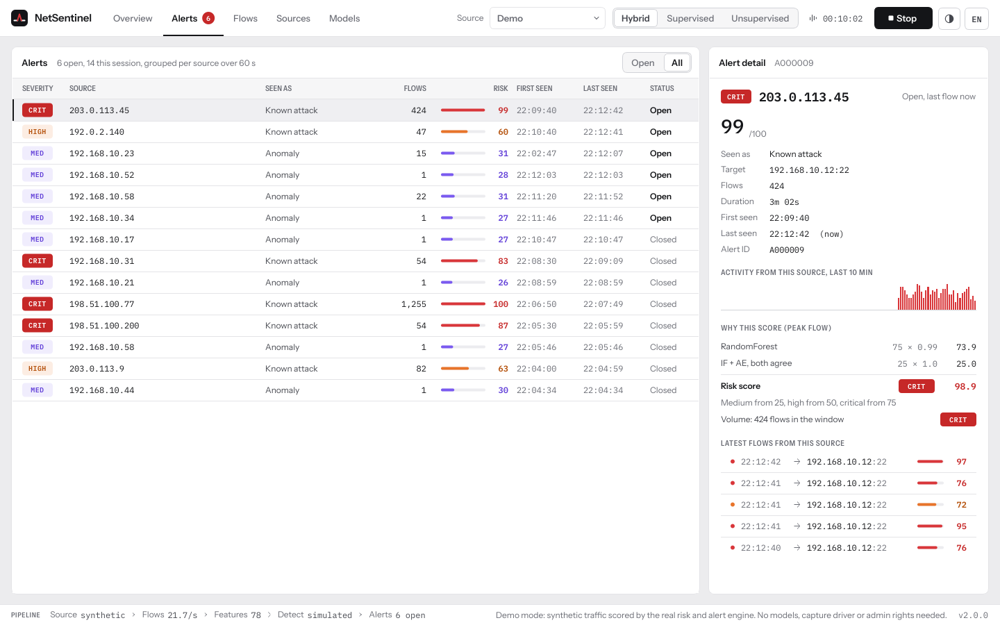
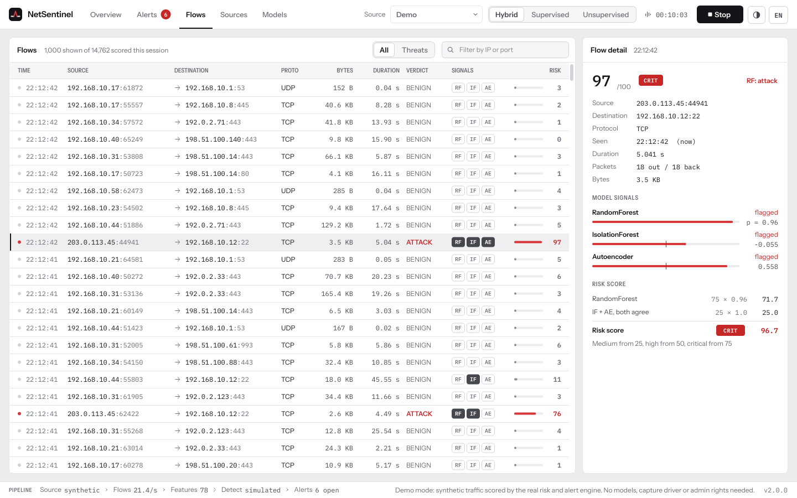
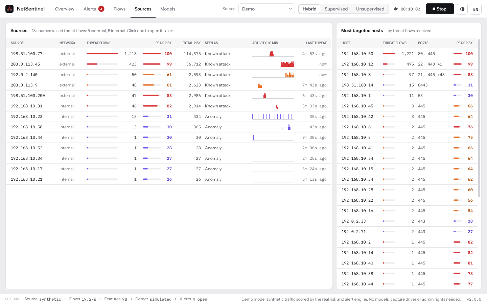
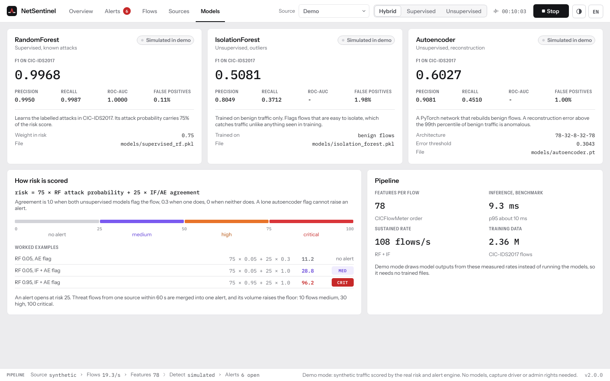
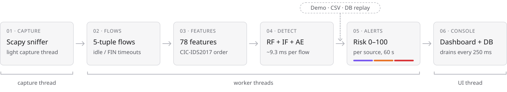

# NetSentinel

**Real-time network intrusion detection with a desktop SOC console.** NetSentinel
captures live traffic, rebuilds it into flows with the 78 CIC-IDS2017 features, scores
every flow with a hybrid detector (RandomForest + IsolationForest + autoencoder), and
groups the threats into low-noise alerts with a 0–100 risk score.

<picture>
  <source media="(prefers-color-scheme: dark)" srcset="assets/screens/overview-dark.png">
  
</picture>

`Python 3.10+` · `PySide6` · `Scapy` · `scikit-learn` · `PyTorch` · `SQLite` · English / Türkçe · MIT

> [!WARNING]
> Capture traffic only on networks you own or are authorized to test. The attack
> simulator refuses public targets and needs an explicit `--yes`.

## Try it in a minute

```bash
cd netsentinel
pip install -r requirements.txt
python dashboard.py --demo
```

Demo mode needs **no trained models, no Npcap and no admin rights**. It streams a
small office network (192.168.10.0/24) and a scripted attack cycle (port scan, FTP and
SSH brute force, HTTP flood, an internal SMB sweep, a web attack, a DNS anomaly and a
slow beacon) through the real risk scorer and alert engine. Scoring, grouping and every
chart run the same code as live detection. Only the model outputs are synthetic, drawn
from the measured detection rates.

## The console

<table>
<tr>
<td width="50%"><picture><source media="(prefers-color-scheme: dark)" srcset="assets/screens/alerts-dark.png"></picture></td>
<td width="50%"><picture><source media="(prefers-color-scheme: dark)" srcset="assets/screens/flows-dark.png"></picture></td>
</tr>
<tr>
<td><b>Alerts</b>: one alert per source per 60 s window, with its activity, the peak flow's score breakdown and the volume floor.</td>
<td><b>Flows</b>: every scored flow, filterable by IP, port or verdict, with RF probability, IsolationForest score and autoencoder error against its threshold.</td>
</tr>
<tr>
<td><picture><source media="(prefers-color-scheme: dark)" srcset="assets/screens/sources-dark.png"></picture></td>
<td><picture><source media="(prefers-color-scheme: dark)" srcset="assets/screens/models-dark.png"></picture></td>
</tr>
<tr>
<td><b>Sources</b>: per-IP threat profiles (internal or external, peak and total risk, 10-minute activity) and the hosts they hit.</td>
<td><b>Models</b>: the three detectors, their CIC-IDS2017 scores, and how risk and severity are computed.</td>
</tr>
</table>

Light and dark themes follow the system and switch from the top bar, and so does the
interface language (English / Türkçe). `Ctrl+1` … `Ctrl+5` jump between views.

## How it works

<picture>
  <source media="(prefers-color-scheme: dark)" srcset="assets/pipeline-dark.svg">
  
</picture>

- **Risk** = 75 × RandomForest attack probability + 25 × unsupervised agreement
  (1.0 when IsolationForest and the autoencoder both flag the flow, 0.3 when one does).
  With a typical benign RF probability of 0.05, a lone autoencoder flag scores about 11
  and raises no alert.
- **Severity**: medium from 25, high from 50, critical from 75. Threat flows from one
  source within 60 s merge into one alert, and its volume sets a floor (10 flows medium,
  30 high, 100 critical), so a port scan is one alert, not 500 lines.
- **Threading**: the capture thread only queues packets. Flow assembly, features and
  inference run on worker threads. The UI drains thread-safe queues every 250 ms and
  never blocks on the network. ([full diagram](netsentinel/docs/architecture.mermaid))

## Results on CIC-IDS2017 (~2.36 M flows)

| Model | F1 | Precision | Recall | ROC-AUC | FPR |
|---|---|---|---|---|---|
| **RandomForest** (supervised) | **0.9968** | 0.9950 | 0.9987 | 1.0000 | 0.11% |
| **Autoencoder** (unsupervised) | 0.6027 | 0.9081 | 0.4510 | — | 1.00% |
| **IsolationForest** (unsupervised) | 0.5081 | 0.8049 | 0.3712 | — | 1.98% |

Inference averages **~9.3 ms per flow** (p95 ~10 ms), about **108 flows/s** sustained.
The supervised model carries known attacks. The unsupervised pair adds zero-day-style
coverage, and the agreement rule keeps its false positives from flooding the alerts.

## Live detection

1. **Npcap** (Windows): install [Npcap](https://npcap.com/) in *WinPcap API-compatible
   mode*. On Linux use `libpcap` with `sudo` or `setcap`.
2. **Models**: put the [CIC-IDS2017 CSVs](https://www.unb.ca/cic/datasets/ids-2017.html)
   in `netsentinel/data/cic-ids-2017/` and train. Install PyTorch for your platform first.
   ```bash
   python -m training.train_supervised        # RandomForest
   python -m training.train_unsupervised      # IsolationForest
   python -m training.autoencoder --epochs 20 # autoencoder
   python -m training.evaluate --pdf          # report + confusion matrices
   ```
3. **Run** as administrator:
   ```bash
   python dashboard.py                         # pick "Live capture" in the top bar
   python main.py --detect --save --duration 60  # headless, writes to SQLite
   ```

The dashboard can also replay a CIC-IDS2017 CSV through the trained models, or replay a
session saved by `main.py --save`.

<details>
<summary>Attack simulation and benchmark (your own machine or lab only)</summary>

```bash
python tests/attack_simulator.py port-scan --target 127.0.0.1 --ports 1-1000 --yes
python tests/attack_simulator.py syn-flood --target 127.0.0.1 --port 80 --count 800 --yes
python tests/benchmark.py
```

To capture 127.0.0.1 on Windows, sniff on `--iface "Npcap Loopback Adapter"`.
</details>

## Tests

```bash
cd netsentinel
pytest -q        # 83 tests: capture, flows, features, detection, alerts, storage, pipeline, demo, i18n
```

Every layer below the UI runs without a network card, admin rights or trained models.

## Project layout

```
netsentinel/
├── capture/  flows/  features/   packet capture -> 5-tuple flows -> 78 features
├── detection/  alerts/  storage/ inference, risk + grouping, SQLite
├── ui/                           PySide6 console: theme, painted widgets, views, demo, i18n
├── training/  reporting/         offline training, evaluation, PDF reports
├── tests/                        pytest suite, attack simulator, benchmark
├── packaging/                    PyInstaller spec, icon, build script
└── dashboard.py · main.py · config.py
tools/                            screenshots.py, build_fonts.py, build_icon.py
```

## Design

A quiet SOC console rather than a hacker terminal. Surfaces are graphite, and **color
only means severity**: violet for medium, orange for high, red for critical. Everything
else is ink and grey, and primary buttons are ink. Charts and tables are painted
with QPainter, icons are inline SVG, and both themes are first-class.

Type is [Instrument Sans](https://github.com/Instrument/instrument-sans) for the
interface and [IBM Plex Mono](https://github.com/IBM/plex) for every number, address
and port. Both are bundled under the SIL Open Font License (`netsentinel/ui/fonts/`).

`python tools/screenshots.py` re-renders every screenshot above off-screen from the
demo, in both themes, in a throwaway home folder. `--lang tr` renders the Turkish UI.

## Türkçe

NetSentinel, canlı ağ trafiğini akışlara ayıran ve her akışı RandomForest, IsolationForest
ve autoencoder ile puanlayan bir saldırı tespit sistemidir. Tehditleri 0–100 risk
puanlı, kaynağa göre gruplanmış alarmlar olarak masaüstü konsolunda gösterir. Arayüz
Türkçe de kullanılabilir: üst çubuktaki **EN / TR** düğmesi dili değiştirir, ya da
`python dashboard.py --demo --lang tr` ile başlatabilirsin. Demo modu model, Npcap ya da
yönetici hakkı istemez. Canlı yakalamayı yalnızca kendi ağında ya da izinli bir
laboratuvarda kullan.

## License

MIT, see [LICENSE](LICENSE). The bundled fonts are under the SIL Open Font License 1.1.
