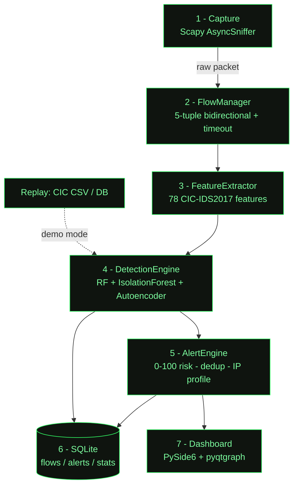

# NetSentinel 🛡️

**Real-Time Network Traffic Anomaly & Intrusion Detection System**

A desktop security tool that captures live network traffic, extracts flow-based
features, detects anomalies/attacks with both supervised (RandomForest) and
unsupervised (IsolationForest + Autoencoder) ML models, raises low-noise alerts,
and visualizes everything in a **phosphor-green terminal-style** PySide6 dashboard.

`Python 3.10+` · `Scapy` · `scikit-learn` · `PyTorch` · `PySide6` · `pyqtgraph` · `SQLite`

> 🇹🇷 **Türkçe açıklama için sayfanın alt yarısına bakın** ([Türkçe](#netsentinel-türkçe)).

> 📁 **This repo contains two language variants of the same project:**
> [`netsentinel/`](netsentinel) (English code & docs) and
> [`netsentineltr/`](netsentineltr) (Turkish code & docs). Pick a folder and
> `cd` into it to run the commands below. · Bu repo aynı projenin iki dil
> sürümünü içerir: `netsentinel/` (İngilizce) ve `netsentineltr/` (Türkçe).

---

## ⚠️ Legal & Ethical Notice

**This tool must only be used on your own network or in an authorized lab.**

- Capturing packets on networks you don't own is **illegal** in most jurisdictions.
- Run attack simulations (port scan, SYN flood) only against **your own machine /
  an isolated test network / your own VM**. The simulator refuses public IP
  targets and requires explicit confirmation (`--yes`).
- All responsibility for misuse lies with the user.

---

## 🧩 Features

| Module | Description | Status |
|---|---|---|
| **Capture** | Live packet capture via Scapy `AsyncSniffer`; light capture thread | ✅ |
| **Flow Manager** | Bidirectional 5-tuple flow assembly, active/idle/FIN-RST timeout | ✅ |
| **Feature Extractor** | ~78 features exactly matching CIC-IDS2017 (microsecond units) | ✅ |
| **Detection Engine** | RandomForest + IsolationForest + PyTorch Autoencoder, shared scaler | ✅ |
| **Alert Engine** | RF-weighted 0-100 risk score, dedup/aggregation, attacker IP profile | ✅ |
| **Storage** | SQLite (flows/alerts/stats), thread-safe batch insert, query API | ✅ |
| **Dashboard** | PySide6 + pyqtgraph live panel, terminal/hacker theme, replay mode | ✅ |
| **Attack Sim & Benchmark** | Safety-guarded attack simulator + performance measurement | ✅ |

---

## 🏛️ Architecture



**Threading model (critical design rule):** the capture thread never does heavy
work - it captures a packet and pushes it to a queue. Flow/feature/inference run
on separate worker threads. The UI only reads thread-safe queues via a `QTimer`
every 250ms; a worker thread never touches a widget. (Full diagram:
[`netsentinel/docs/architecture.mermaid`](netsentinel/docs/architecture.mermaid))

---

## 📊 Results (CIC-IDS2017, ~2.36M flows)

| Model | F1 | Precision | Recall | ROC-AUC | FPR |
|---|---|---|---|---|---|
| **RandomForest** (supervised) | **0.9968** | 0.9950 | 0.9987 | 1.0000 | 0.11% |
| **Autoencoder** (unsupervised) | 0.6027 | 0.9081 | 0.4510 | — | 1.00% |
| **IsolationForest** (unsupervised) | 0.5081 | 0.8049 | 0.3712 | — | 1.98% |

**Performance:** inference mean **~9.3 ms/flow** (p95 ~10 ms), sustainable
**~108 flows/s** (RF + IsolationForest, hybrid). Inference is far below the 50 ms
target - a single flow is not the bottleneck.

> The supervised model is very strong on known attacks; the unsupervised models
> are for zero-day-like detection (lower recall, higher FPR). In hybrid mode the
> risk score is RF-weighted + unsupervised agreement, so a single unsupervised
> flag does not produce a false-alarm flood.

---

## 📦 Installation

### 1. Npcap (Windows - required)
Install [Npcap](https://npcap.com/) with **"Install Npcap in WinPcap API-compatible
Mode"** checked. (The "Npcap Loopback Adapter" is also installed, to capture
loopback traffic.) On Linux: `libpcap` + `sudo`/`setcap`.

### 2. Dependencies
```bash
python -m venv venv
venv\Scripts\activate            # Windows
pip install -r requirements.txt
# Install PyTorch per your platform: https://pytorch.org/get-started/locally/
```

### 3. Train the models (Phase 3)
Put the [CIC-IDS2017 CSV](https://www.unb.ca/cic/datasets/ids-2017.html) files
under `data/cic-ids-2017/`, then:
```bash
python -m training.train_supervised        # RandomForest
python -m training.train_unsupervised       # IsolationForest
python -m training.autoencoder --epochs 20  # PyTorch Autoencoder
python -m training.evaluate --pdf           # combined report + confusion matrices
```

---

## 🚀 Usage

### Live detection (CLI)
```bash
# Run as ADMINISTRATOR on Windows:
python main.py --detect --save --duration 60
python main.py --detect --mode supervised --verbose
```

### Dashboard
```bash
python dashboard.py
#  Source "Live"       -> real-time capture
#  Source "Replay: CSV" -> runs a CIC-IDS2017 CSV through the models (ideal for a demo/GIF)
#  Source "Replay: DB"  -> replays a past session
```

### Controlled attack simulation (your own / lab network only)
```bash
python tests/attack_simulator.py port-scan --target 127.0.0.1 --ports 1-1000 --yes
python tests/attack_simulator.py syn-flood --target 127.0.0.1 --port 80 --count 800 --yes
```
> Note: to capture 127.0.0.1 traffic on Windows, run the sniffer with
> `--iface "Npcap Loopback Adapter"`.

### Performance benchmark
```bash
python tests/benchmark.py
```

---

## 🧠 ML / Dataset

- **Primary data:** CIC-IDS2017 (DDoS, PortScan, DoS Hulk/GoldenEye/Slowloris,
  Brute Force, Web Attack, Infiltration, Botnet, Heartbleed).
- **Feature space:** exactly matches CICFlowMeter's 78 features (name + order).
  The live `FeatureExtractor` and training share the same space - critical for
  the accuracy of live detection.
- **Data prep:** Inf/NaN cleaning, binary labels, stratified 70/30 split,
  StandardScaler fit on train only (no data leakage).
- **Unsupervised models** are trained on BENIGN traffic only (the autoencoder
  threshold = the 99th percentile of the BENIGN reconstruction error).

---

## 🧪 Tests

```bash
pytest -q          # 75 unit/integration tests
```
The architecture is deliberately layered and UI/network-independent: the capture,
flow, feature, detection, alert, storage and pipeline layers are testable without
hardware or a network.

---

## 📂 Project Layout

```
netsentinel/
├── capture/      # packet capture (Scapy)
├── flows/        # 5-tuple flow management + timeout
├── features/     # CIC-IDS2017-compatible feature extraction
├── detection/    # ML inference engine + worker + result
├── alerts/       # risk scoring + alert aggregation
├── storage/      # SQLite layer + batch writer
├── ui/           # PySide6 dashboard (theme, pipeline, widgets)
├── training/     # offline training: prepare/supervised/unsupervised/AE/evaluate
├── reporting/    # PDF report generation
├── tests/        # pytest suite + attack_simulator + benchmark
├── docs/         # architecture diagram
├── packaging/    # PyInstaller spec + build script
├── config.py · main.py · dashboard.py
```

---

## 📄 License

MIT — see [LICENSE](netsentinel/LICENSE).

<br/><br/>

---
---

<a name="netsentinel-türkçe"></a>
# NetSentinel 🛡️ (Türkçe)

**Gerçek Zamanlı Ağ Trafiği Anomali & Saldırı Tespit Sistemi**

Canlı ağ trafiğini yakalayıp akış (flow) bazlı özellikler çıkaran, hem denetimli
(RandomForest) hem denetimsiz (IsolationForest + Autoencoder) ML modelleriyle
anomali/saldırı tespiti yapan, gürültüsüz alarmlar üreten ve **fosfor yeşil
terminal estetiğinde** bir PySide6 dashboard'da görselleştiren masaüstü güvenlik
aracı.

---

## ⚠️ Yasal & Etik Uyarı

**Bu araç YALNIZCA kendi ağında veya yetkili bir laboratuvar ortamında kullanılmalıdır.**

- İzinsiz ağlarda paket yakalamak çoğu ülkede **yasa dışıdır**.
- Saldırı simülasyonlarını yalnızca **kendi makinende / izole bir test ağında /
  kendi VM'inde** çalıştır. Simülatör public IP hedeflerini reddeder ve açık
  onay (`--yes`) ister.
- Kötüye kullanımdan doğacak sorumluluk tamamen kullanıcıya aittir.

---

## 🧩 Özellikler

| Modül | Açıklama | Durum |
|---|---|---|
| **Capture** | Scapy `AsyncSniffer` ile canlı paket yakalama; hafif yakalama thread'i | ✅ |
| **Flow Manager** | Bidirectional 5-tuple akış birleştirme, active/idle/FIN-RST timeout | ✅ |
| **Feature Extractor** | CIC-IDS2017 ile birebir uyumlu ~78 özellik (µs birimleri) | ✅ |
| **Detection Engine** | RandomForest + IsolationForest + PyTorch Autoencoder, ortak scaler | ✅ |
| **Alert Engine** | RF-ağırlıklı 0-100 risk skoru, dedup/aggregation, saldırgan IP profili | ✅ |
| **Storage** | SQLite (flows/alerts/stats), thread-safe batch insert, sorgu API | ✅ |
| **Dashboard** | PySide6 + pyqtgraph canlı panel, terminal/hacker teması, replay modu | ✅ |
| **Saldırı Sim & Benchmark** | Güvenlik korumalı saldırı simülatörü + performans ölçümü | ✅ |

---

## 📊 Sonuçlar (CIC-IDS2017, ~2.36M akış)

| Model | F1 | Precision | Recall | ROC-AUC | FPR |
|---|---|---|---|---|---|
| **RandomForest** (denetimli) | **0.9968** | 0.9950 | 0.9987 | 1.0000 | %0.11 |
| **Autoencoder** (denetimsiz) | 0.6027 | 0.9081 | 0.4510 | — | %1.00 |
| **IsolationForest** (denetimsiz) | 0.5081 | 0.8049 | 0.3712 | — | %1.98 |

**Performans:** inference ortalama **~9.3 ms/akış** (p95 ~10 ms), sürdürülebilir
**~108 akış/sn**. 50 ms hedefinin çok altında.

> Denetimli model bilinen saldırılarda çok güçlüdür; denetimsiz modeller sıfır-gün
> benzeri tespit içindir. Hybrid modda risk skoru RF-ağırlıklı + denetimsiz
> mutabakatla hesaplanır; böylece tek bir denetimsiz bayrak yanlış alarm seli
> üretmez.

---

## 📦 Kurulum

### 1. Npcap (Windows — zorunlu)
[Npcap](https://npcap.com/) kur; **"Install Npcap in WinPcap API-compatible Mode"**
seçeneğini işaretle. (127.0.0.1 trafiğini yakalamak için "Npcap Loopback Adapter"
da kurulur.) Linux'ta `libpcap` + `sudo`/`setcap`.

### 2. Bağımlılıklar
```bash
python -m venv venv
venv\Scripts\activate
pip install -r requirements.txt
# PyTorch'u platformuna göre: https://pytorch.org/get-started/locally/
```

### 3. Modelleri eğit
[CIC-IDS2017 CSV](https://www.unb.ca/cic/datasets/ids-2017.html) dosyalarını
`data/cic-ids-2017/` altına koy, sonra:
```bash
python -m training.train_supervised
python -m training.train_unsupervised
python -m training.autoencoder --epochs 20
python -m training.evaluate --pdf
```

---

## 🚀 Kullanım

```bash
# Canlı tespit (Windows'ta YÖNETİCİ terminalde):
python main.py --detect --save --duration 60

# Dashboard:
python dashboard.py
#   Kaynak "Replay: CSV" -> bir CIC CSV seç -> dashboard gerçek saldırılarla canlanır

# Kontrollü saldırı (yalnız kendi/lab ağı):
python tests/attack_simulator.py port-scan --target 127.0.0.1 --ports 1-1000 --yes

# Performans:
python tests/benchmark.py
```
> Not: Windows'ta 127.0.0.1 trafiğini yakalamak için sniffer'ı
> `--iface "Npcap Loopback Adapter"` ile çalıştır.

---

## 🧪 Testler

```bash
pytest -q          # 75 unit/entegrasyon testi
```
Mimari kasıtlı olarak katmanlı ve UI/ağ-bağımsız: tüm katmanlar donanım/ağ
olmadan test edilebilir.

---

## 📄 Lisans

MIT — bkz. [LICENSE](netsentineltr/LICENSE).
